# Arquitetura — Plataforma TicketMaster

> Diagramas de arquitetura (C4 + componentes + sequência) em Mermaid.
> Complementa `plan.md` e é a referência visual das 10 evoluções.

---

## 1. Contexto (C4 — nível 1)

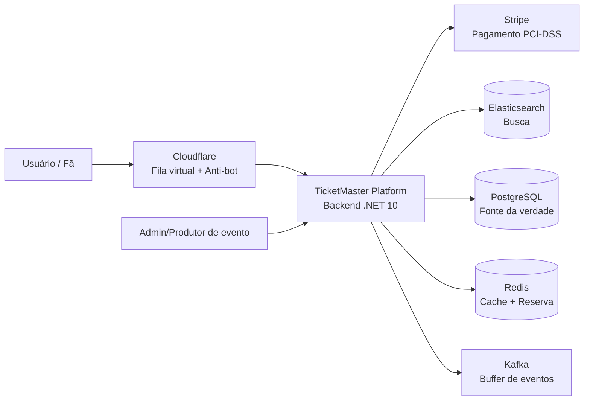

---

## 2. Contêineres (C4 — nível 2)

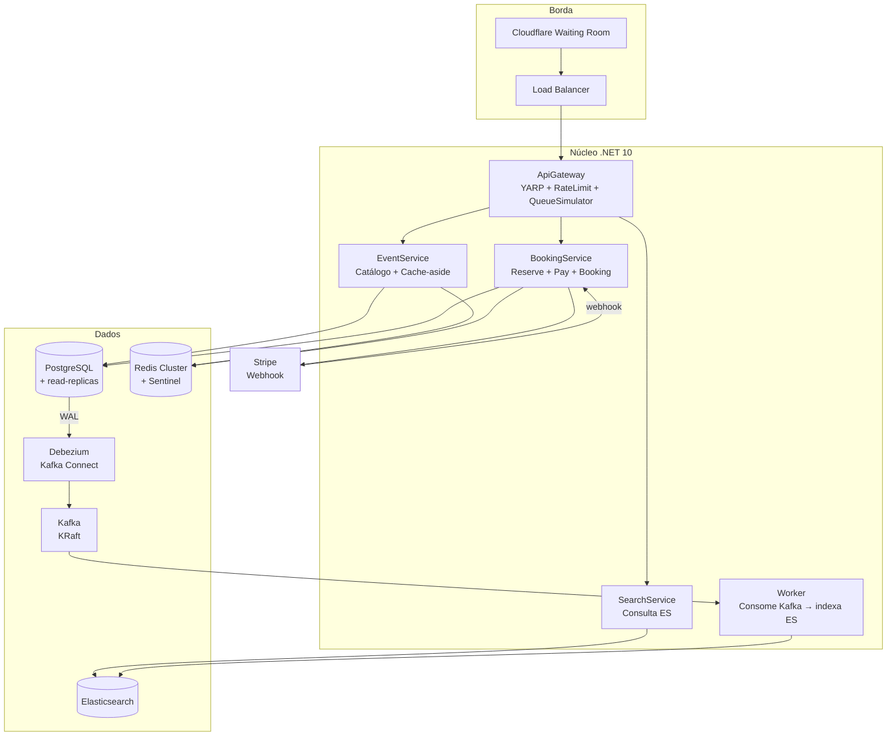

---

## 3. Evoluções da arquitetura (1 → 10)

### E1 — Base

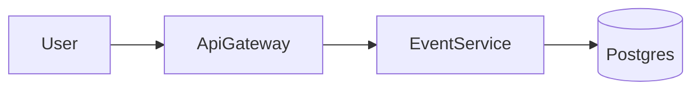

### E2 — Cache-aside (RNF-5/6)

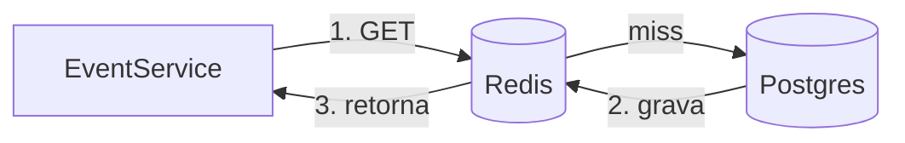

### E3/E4 — Full-text + Search Service + CDC (RNF-3/5)

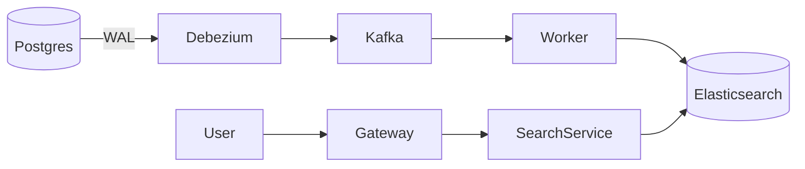

### E6/E7/E8 — Booking + Redis + Stripe + Postgres (RNF-4, RF-3)

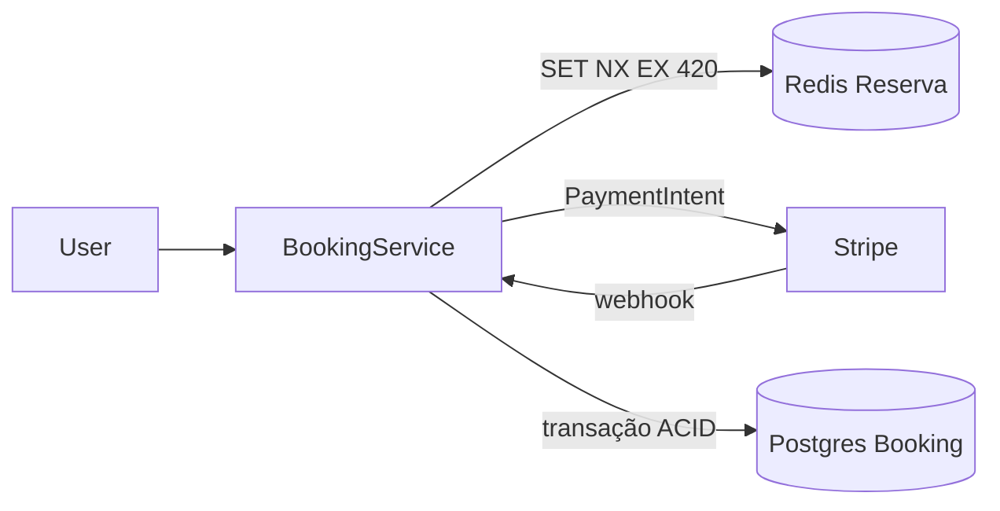

### E9 — Fila virtual (RNF-1/2)

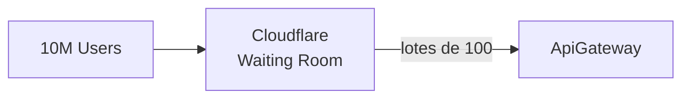

### E10 — Alta disponibilidade (RNF-7)

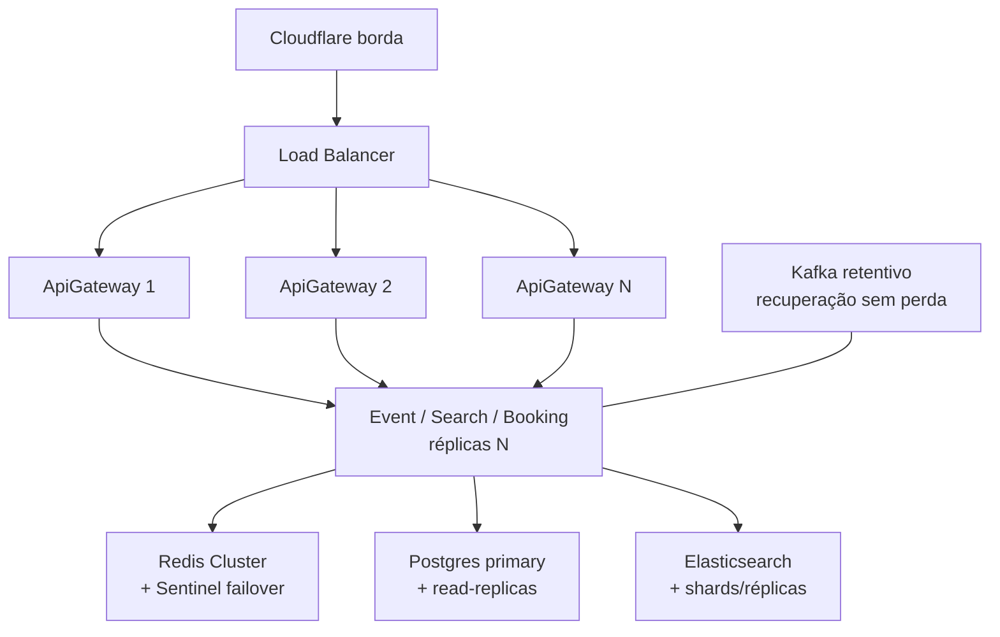

---

## 4. Sequência — Pesquisa (US2)

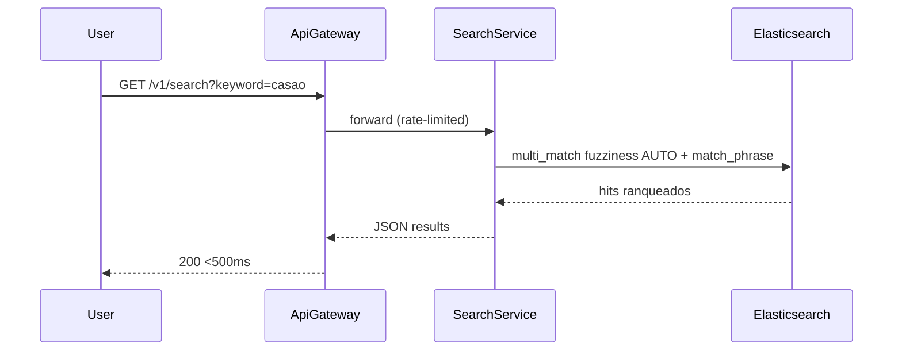

---

## 5. Sequência — Compra (US3)

```mermaid
sequenceDiagram
    participant U as User
    participant GW as ApiGateway
    participant BK as BookingService
    participant RD as Redis
    participant STR as Stripe
    participant PG as Postgres

    U->>GW: POST /v1/bookings/reserve {tickets,userId}
    GW->>BK: forward
    BK->>RD: SET reserve:ticket:N userId NX EX 420
    alt assento livre
        RD-->>BK: OK
        BK-->>U: 202 reservationId + expiresAt
    else assento ocupado
        RD-->>BK: nil
        BK-->>U: 409 Conflict
    end

    U->>GW: POST /v1/bookings/{id}/pay {paymentMethodId}
    GW->>BK: forward
    BK->>STR: create+confirm PaymentIntent
    STR-->>BK: pending / succeeded (requires_action)
    BK-->>U: 202 paymentRef (status pendente)
    Note over STR,BK: webhook assíncrono (idempotente, assinado)
    STR->>BK: POST /v1/webhooks/stripe (payment_intent.succeeded)
    BK->>PG: BEGIN; SELECT..FOR UPDATE; UPDATE ticket=booked; INSERT booking; COMMIT
    BK->>RD: DEL reserve:ticket:N
    Note over BK,U: GET /v1/bookings/{id} → confirmed
```

---

## 6. Sequência — Sincronização CDC (Evoluções 4/5/8)

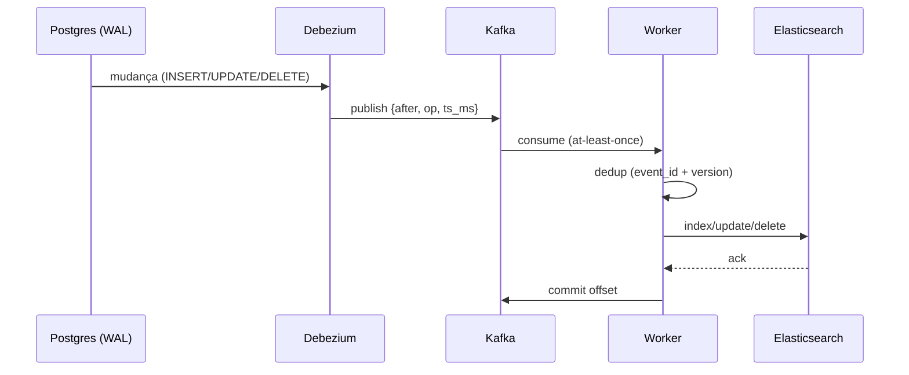

---

## 7. Diagrama de implantação (WSL Ubuntu + Docker)

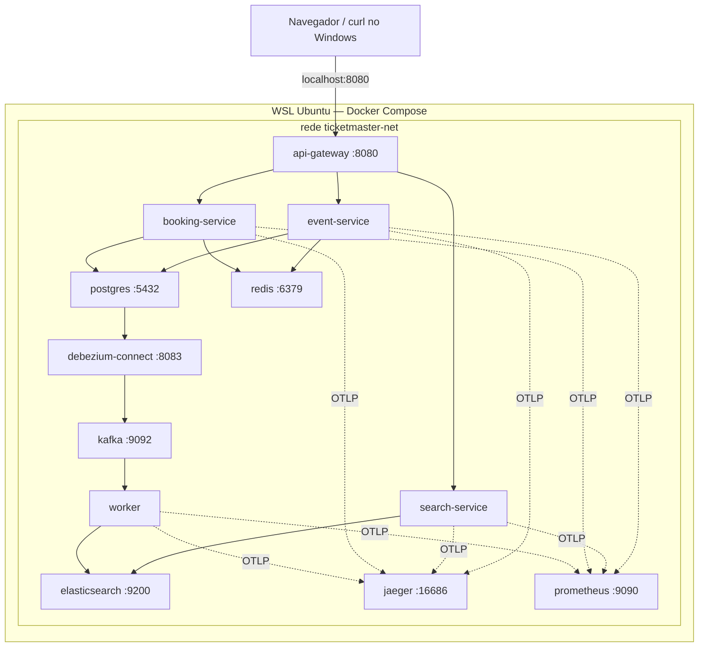

---

## 8. Rastreabilidade requisito → componente

| Requisito | Componente(s) | Diagrama |
|-----------|---------------|----------|
| RNF-001 10M | Cloudflare + LB + escala horizontal | E9, E10 |
| RNF-002 anti-bot | Cloudflare (borda) | E9 |
| RNF-003 busca | Elasticsearch + analisador pt-BR | E3/E4, Seq.4 |
| RNF-004 concorrência | Redis `SET NX EX` + Postgres ACID | E6, Seq.5 |
| RNF-005 <500ms | Redis cache + Elasticsearch | E2, E3 |
| RNF-006 100:1 | Cache + read-replicas | E2, E10 |
| RNF-007 HA | Redundância em camadas | E10 |
