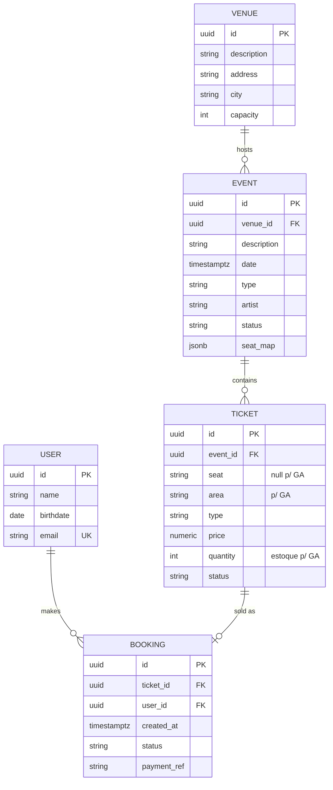

# Data Model — Plataforma TicketMaster

> Fase 1 do Spec Kit: modelo de dados físico/lógico da fonte da verdade (PostgreSQL) e dos estados voláteis (Redis) e do índice (Elasticsearch).

---

## 1. Diagrama Entidade-Relacionamento (ER)



---

## 2. Schemas SQL (PostgreSQL 17)

### 2.1 `users`

```sql
CREATE TABLE users (
    id          uuid PRIMARY KEY DEFAULT gen_random_uuid(),
    name        text NOT NULL,
    birthdate   date,
    email       text NOT NULL UNIQUE,
    created_at  timestamptz NOT NULL DEFAULT now()
);
```

### 2.2 `venues`

```sql
CREATE TABLE venues (
    id          uuid PRIMARY KEY DEFAULT gen_random_uuid(),
    description text NOT NULL,
    address     text,
    city        text,
    capacity    integer NOT NULL CHECK (capacity > 0)
);
```

### 2.3 `events`

```sql
CREATE TABLE events (
    id          uuid PRIMARY KEY DEFAULT gen_random_uuid(),
    venue_id    uuid NOT NULL REFERENCES venues(id),
    description text NOT NULL,
    date        timestamptz NOT NULL,
    type        text NOT NULL,                 -- show | sport | theater
    artist      text,
    status      text NOT NULL DEFAULT 'draft', -- draft | published | sold_out | cancelled
    seat_map    jsonb NOT NULL DEFAULT '[]'::jsonb,
    created_at  timestamptz NOT NULL DEFAULT now(),
    updated_at  timestamptz NOT NULL DEFAULT now()
);

CREATE INDEX idx_events_date   ON events (date);
CREATE INDEX idx_events_status ON events (status) WHERE status = 'published';
CREATE INDEX idx_events_seat_map ON events USING gin (seat_map);
```

### 2.4 `tickets`

```sql
CREATE TABLE tickets (
    id         uuid PRIMARY KEY DEFAULT gen_random_uuid(),
    event_id   uuid NOT NULL REFERENCES events(id),
    seat       text,                           -- assento numerado ("A1"); NULL p/ pista/GA
    area       text,                           -- área de pista/GA (ex.: "pista")
    type       text NOT NULL,                  -- pista | vip | camarote | meia | inteira
    price      numeric(10,2) NOT NULL CHECK (price >= 0),
    quantity   integer NOT NULL DEFAULT 1 CHECK (quantity >= 0), -- 1 p/ numerado; estoque p/ GA
    capacity   integer NOT NULL DEFAULT 1 CHECK (capacity > 0),  -- capacidade inicial da área (GA)
    status     text NOT NULL DEFAULT 'available', -- available | unavailable | booked
    CONSTRAINT chk_ticket_mode CHECK (
        (seat IS NOT NULL AND area IS NULL) OR
        (seat IS NULL     AND area IS NOT NULL)
    )
);

-- Assento numerado: 1 linha por assento (quantity = 1)
CREATE UNIQUE INDEX uq_ticket_seat ON tickets (event_id, seat) WHERE seat IS NOT NULL;
-- Pista/GA: 1 linha por área (quantity = estoque restante)
CREATE UNIQUE INDEX uq_ticket_area ON tickets (event_id, area) WHERE area IS NOT NULL;
CREATE INDEX idx_tickets_event_status ON tickets (event_id, status);
```

> **Invariantes**: `UNIQUE (event_id, seat)` (assento numerado) e `UNIQUE (event_id, area)` (pista/GA) são a última linha de defesa contra venda dupla no banco — mesmo que a reserva no Redis falhe, a transação não vende o mesmo assento duas vezes nem excede a capacidade da área.

### 2.5 `bookings`

```sql
CREATE TABLE bookings (
    id           uuid PRIMARY KEY DEFAULT gen_random_uuid(),
    ticket_id    uuid NOT NULL REFERENCES tickets(id),
    user_id      uuid NOT NULL REFERENCES users(id),
    status       text NOT NULL DEFAULT 'confirmed', -- confirmed | cancelled | refunded
    payment_ref  text,                            -- id do PaymentIntent no Stripe
    idempotency_key text NOT NULL UNIQUE,         -- dedup de webhook/retry
    created_at   timestamptz NOT NULL DEFAULT now()
);

CREATE INDEX idx_bookings_user ON bookings (user_id);
```

### 2.6 Transação de venda (efetivação)

```sql
BEGIN;
    -- Re-verifica dentro da transação (anti-oversell no Postgres):
    SELECT id FROM tickets
     WHERE id = $1 AND status = 'available'
       FOR UPDATE;

    -- Se não retornar, ROLLBACK e responde 409.

    UPDATE tickets SET status = 'booked' WHERE id = $1;

    INSERT INTO bookings (ticket_id, user_id, payment_ref, idempotency_key)
    VALUES ($1, $2, $3, $4)
    ON CONFLICT (idempotency_key) DO NOTHING;
COMMIT;
```

> A checagem final de estoque acontece **dentro da transação ACID**. A reserva no Redis é a barreira de alta vazão; o `SELECT … FOR UPDATE` é a garantia de integridade.

---

## 3. Estados voláteis — Redis

### 3.1 Cache de leitura (cache-aside)

| Chave | Valor | TTL |
|-------|-------|-----|
| `event:{eventId}` | JSON do evento (serializado) | 5 min |
| `events:page:{cursor}` | JSON paginado da listagem | 5 min |

### 3.2 Reserva temporária (anti-oversell)

| Chave | Valor | TTL |
|-------|-------|-----|
| `reserve:ticket:{ticketId}` | `userId` (assento numerado) | **420s (7 min)** |
| `reserve:ticket:{ticketId}` | `count` (estoque reservado da área GA) | **420s (7 min)** |

**Assento numerado — operação atômica** (nunca `GET`+`SET`):

```bash
SET reserve:ticket:{ticketId} {userId} NX EX 420
# retorna OK  → reserva adquirida
# retorna nil → assento já reservado → 409 Conflict
```

**Pista/GA — decremento atômico de estoque** (script Lua via `EVAL`, sem oversell):

```lua
-- reserva N vagas se o estoque atual suporta; senão falha (rollback do carrinho)
local estoque = tonumber(redis.call('GET', KEYS[1]) or '0')
local n = tonumber(ARGV[1])
if estoque >= n then
  redis.call('SET', KEYS[1], estoque - n, 'EX', 420)
  return 1
end
return 0  -- capacidade insuficiente
```

**Atomicidade do carrinho (tudo ou nada)**: a reserva de múltiplos itens executa todas as operações e, se qualquer uma falhar, libera as já adquiridas (rollback) — nenhum item fica reservado parcialmente.

**Liberação**: expiração automática (TTL) ou `DEL`/`INCRBY` explícito ao efetivar/falhar.

---

## 4. Índice de busca — Elasticsearch

### 4.1 Mapping (`events-index`)

```json
{
  "mappings": {
    "properties": {
      "event_id":      { "type": "keyword" },
      "description":   { "type": "text", "analyzer": "portuguese" },
      "artist":        { "type": "text", "analyzer": "portuguese" },
      "type":          { "type": "keyword" },
      "date":          { "type": "date" },
      "status":        { "type": "keyword" },
      "venue":         { "type": "text", "analyzer": "portuguese" },
      "city":          { "type": "keyword" },
      "price_min":     { "type": "scaled_float", "scaling_factor": 100 }
    }
  }
}
```

**Analisador pt-BR**: lowercase + `asciifolding` (tira acentos) + stemming português + sinônimos ("casa"→"casas, casarão, casinha").

**Query (typo tolerance)**: `multi_match` com `fuzziness: AUTO` + `match_phrase` para relevância, filtros por `date`, `type` e `city` (e `status`).

---

## 5. Documentos CDC (Debezium)

O Debezium publica as mudanças das tabelas `events` e `tickets` no Kafka (formato achatado via `ExtractNewRecordState`). O Worker converte para o documento do Elasticsearch. Schemas completos em [`contracts/events.md`](contracts/events.md).

---

## 6. Concorrência e consistência (resumo)

1. **Reserva — assento numerado**: `SET NX EX 420` no Redis — sub-ms, sem disputa no banco.
2. **Reserva — pista/GA**: decremento atômico de estoque (script Lua) — impede oversell da capacidade da área.
3. **Atomicidade do carrinho**: reserva de múltiplos itens é tudo-ou-nada (rollback se qualquer item falhar).
4. **Efetivação** (consistência): transação Postgres com `SELECT … FOR UPDATE` + `UPDATE` + `INSERT … ON CONFLICT`.
5. **Defesa em profundidade**: `UNIQUE (event_id, seat)` + `UNIQUE (event_id, area)` + `UNIQUE (idempotency_key)`.
6. **Propagação**: CDC (Debezium → Kafka → Worker) mantém ES consistente eventualmente (segundos).
